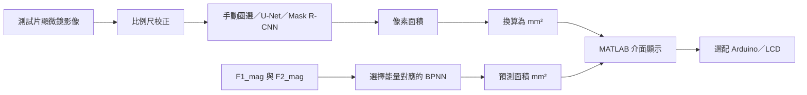

# 智慧超音波空穴預測系統

**Smart Ultrasound Cavitation Predictor** 是將測試片的顯微鏡影像轉換成面積資料，再用頻譜特徵預測空穴面積的大學專題。系統結合手動量測、U-Net、Mask R-CNN 與 BPNN，透過 MATLAB 介面操作。

這裡整理專題的整體流程、團隊分工及已公開程式。影像來源是**超音波作用於測試片後拍攝的顯微鏡影像**；目前成果適用於這組實驗條件，尚未做臨床驗證。

| 想了解的內容 | 建議入口 |
| --- | --- |
| 專題做什麼、我負責哪些工作 | 本頁的流程與分工 |
| 實際載入模型並預測面積 | [`demo_bpnn.m`](demo_bpnn.m) 與[執行說明](docs/SETUP.md) |
| 資料格式、模型差異 | [資料與模型](docs/DATA_AND_MODELS.md) |
| U-Net 各版本與訓練流程 | [BioUS-Net](https://github.com/tsengwt1210/BioUS-Net) |
| 歷史結果與這次檢查的範圍 | [結果與限制](docs/RESULTS_AND_LIMITATIONS.md)、[驗證紀錄](docs/VALIDATION.md) |

## 從影像到面積



影像量測與 BPNN 預測是兩條輸入路徑。前者需要影像及比例尺；後者輸入 `F1_mag`、`F2_mag` 與能量條件，使用保存的模型輸出面積。

比例尺的單位是 `mm/pixel`，因此 `面積 mm² = 像素面積 × 比例尺²`。例如 1 mm 的參考線長 100 pixels，區域面積為 5,000 pixels²，換算結果是 `5000 × (1/100)² = 0.5 mm²`。這是換算示例，非實驗結果。

## 最小執行範例

BPNN 範例使用本庫原已公開的三個 `.mat` 模型及 `test.xlsx`，不需攝影機或 Python。需要 MATLAB 與 **Deep Learning Toolbox**。

```bash
git clone https://github.com/tsengwt1210/Smart-Ultrasound-Cavitation-Predictor.git
```

在 MATLAB 中切換到下載的專案資料夾，執行：

```matlab
results = demo_bpnn();

% 使用 test.xlsx 的第一筆 0.8J 特徵；數值尺度須與原實驗一致。
[area_mm2, details] = predict_area(23931, 4013, '0.8J');
```

`predict_area` 保留原模型的前後處理，並以保存的 `T_max` 將正規化輸出還原為面積。範例用途是檢查載入與推論；`test.xlsx` 包含原實驗資料，檔名不代表它是獨立測試集。完整環境與 GUI 啟動方式見[執行說明](docs/SETUP.md)。

## 程式與版本

| 檔案 | 用途與狀態 |
| --- | --- |
| [`predict_area.m`](predict_area.m) | 新增的獨立 BPNN 推論入口，支援三種能量與輸入檢查 |
| [`demo_bpnn.m`](demo_bpnn.m) | 各能量取一筆既有特徵，展示模型載入流程 |
| `trained_model_*.mat` | 已公開的三份 BPNN 模型，完整檔名及結構見[模型表](docs/DATA_AND_MODELS.md) |
| [`BPNN_feedforwardnet_savenet.m`](BPNN_feedforwardnet_savenet.m) | 歷史訓練與儲存腳本，設定與現有三模型不同 |
| [`new.m`](new.m) | 早期攝影機手動量測與 BPNN 整合程式 |
| `newver2fullscreen.mlapp`、`newver3fullscreen.mlapp`、`newver4.mlapp` | 已公開的團隊 GUI 版本；操作入口及外部檔案見[GUI 說明](docs/GUI.md) |
| [`rcnn_predict.py`](rcnn_predict.py) | 團隊 Mask R-CNN 的 Python 推論接口；權重需另備 |
| [`Unet_V6.m`](Unet_V6.m) | 專題保留的 U-Net 腳本快照；版本整理以 [BioUS-Net](https://github.com/tsengwt1210/BioUS-Net) 為主 |

## 我的工作與團隊分工

我主要負責手動框選面積量測程式、獨立 U-Net 流程、BPNN 訓練與分析，以及後續 MedSAM 導入與自動化。我也規劃介面版面、操作選項及 MATLAB／Python 的串接流程，將模組交給 GUI 組員整合。

| 成員 | 主要工作 |
| --- | --- |
| 曾琬婷 | 手動面積量測、U-Net、BPNN、MedSAM 導入與自動化、介面與流程規劃 |
| 楊聖全 | Arduino、412 筆影像標註、競賽報告與主要答辯 |
| 陳姿璇 | Mask R-CNN、競賽影片剪輯 |
| 趙崇凱 | GUI 程式與模組串接 |

本庫的 GUI 及 Mask R-CNN 是團隊整合成果。MedSAM 是後續延伸工作，目前未包含在這份公開程式中；涉及 Mask R-CNN 的自動流程沿用組員模型。

## 實驗紀錄如何解讀

- **U-Net：** 專題記錄的五折平均 Pixel Accuracy 為 **97.77% ± 0.33%**。這是像素準確率；分割品質仍需搭配類別比例、Dice／IoU 與面積誤差檢查。模型版本與資料需求見 [BioUS-Net](https://github.com/tsengwt1210/BioUS-Net)。
- **BPNN：** 0.8J、隱藏層 `[5, 3, 2]` 的歷史報告記錄最佳驗證 MSE 為 **5.0596 × 10⁻⁶**，目標是正規化面積。此數字不是 RMSE，也不是獨立測試誤差；模型檔未保存當次訓練紀錄，不能只由權重重新證實該數字。

資料切分、搜尋與保存模型的差異，以及尚未驗證的範圍詳見[結果與限制](docs/RESULTS_AND_LIMITATIONS.md)。

## 團隊介面畫面

下圖沿用本庫原有的公開操作畫面；GUI 原始檔與功能對應見 [GUI 說明](docs/GUI.md)。


## 文件與使用範圍

[執行說明](docs/SETUP.md) · [資料與模型](docs/DATA_AND_MODELS.md) · [GUI 操作](docs/GUI.md) · [結果與限制](docs/RESULTS_AND_LIMITATIONS.md) · [驗證紀錄](docs/VALIDATION.md) · [變更紀錄](CHANGELOG.md)

本庫供專題展示與程式閱讀，目前未指定開放原始碼授權。引用團隊成果或重用程式、模型與資料前，請先確認相應授權；外部套件依各自授權使用。
