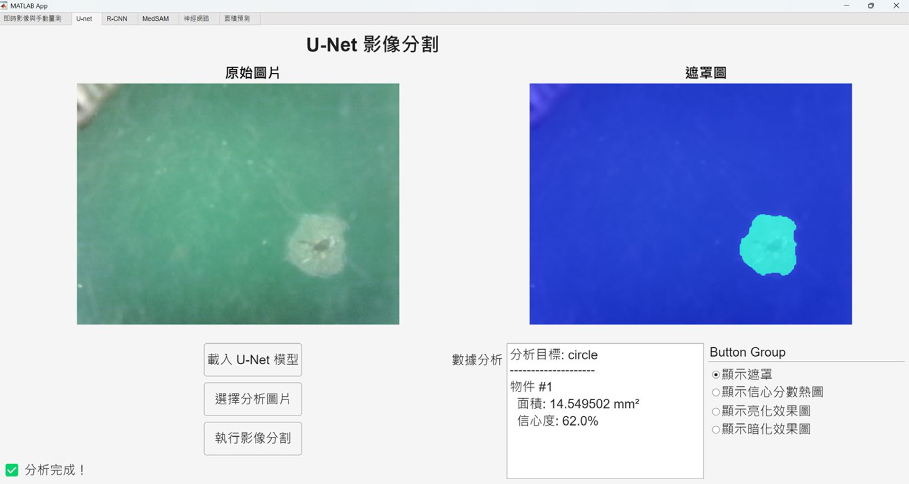
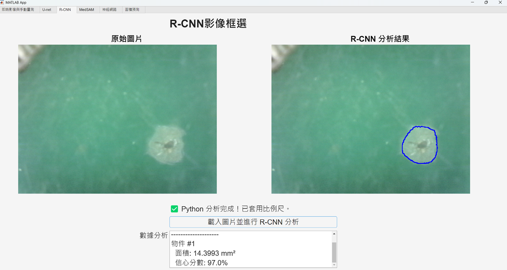
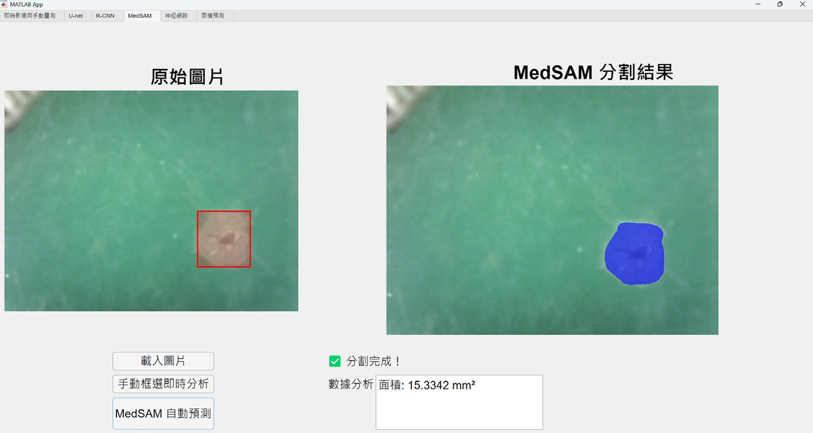

# GUI 版本與操作

`newver2fullscreen.mlapp`、`newver3fullscreen.mlapp`、`newver4.mlapp` 是原本已公開的團隊整合版本。介面程式由趙崇凱負責；此處保留供查看各模組如何串接。可先在 MATLAB App Designer 開啟 `newver4.mlapp` 閱讀回呼函數，完整執行前需備妥對應資料及裝置。

本頁圖片改用專題報告中的較新版介面，與本庫較早公開的 `.mlapp` 可能有版面或功能差異。MedSAM 圖片展示後續整合成果，對應程式與權重尚未包含在本庫。

## 各分頁需要的內容

| 分頁 | 輸入與額外需求 | 輸出 |
| --- | --- | --- |
| 影像載入與手動量測 | 本機圖片或 USB 顯微鏡攝影機、比例尺 | 圈選面積、截圖 |
| U-Net | 相容的 `.mat` 模型、圖片、比例尺 | 遮罩／疊圖、面積、模型分數 |
| Mask R-CNN | `rcnn_predict.py`、`maskrcnn_model.pth`、可用的 Python 環境 | 輪廓圖、每個區域的像素面積與分數 |
| BPNN 訓練 | 符合[資料格式](DATA_AND_MODELS.md)的 Excel | 訓練圖與保存模型 |
| BPNN 面積預測 | 能量條件、F1_mag、F2_mag、對應模型 | 預測面積 |

U-Net 與 Mask R-CNN 權重不在本庫。只想檢查數值推論時，直接使用 [`demo_bpnn`](../demo_bpnn.m) 可避開攝影機與 Python 環境需求。

## 手動量測

先載入圖片或啟動相機，設定比例尺後再圈選區域。早期 [`new.m`](../new.m) 使用鍵盤操作：`r` 選兩個相距 1 mm 的參考點、`h` 輸入 `mm/pixel`、`c` 截圖、`m` 圈選多邊形、`p` 呼叫 BPNN 預測、`q` 離開。這組快捷鍵屬於早期程式，不應套用到所有 GUI 分頁。

## U-Net 分割

載入相容模型與圖片，執行分割後查看遮罩、熱圖或疊圖。面積的物理單位由比例尺決定，信心分數不能取代與人工標註的比對。

## Mask R-CNN

GUI 執行 `python rcnn_predict.py <model_path> <image_path> <output_path>`。程式保留類別 1 且分數至少 0.8 的預測，將 mask 以 0.5 閾值二值化，再繪製外輪廓並回傳輪廓面積。現有接口繪製的是輪廓，沒有將 bounding box 畫在輸出圖上。

## MedSAM 後續整合畫面

左側顯示輸入影像與紅色提示框，右側顯示分割遮罩，介面保留手動框選及自動預測入口。本庫目前僅展示這張操作畫面，未附 MedSAM 執行程式與權重。

## 圖片來源與解析度

三張圖對應《專題報告_RMSE.pdf》的第 12–14 頁（PDF 檔案頁序；內頁頁碼為 8–10），使用報告原稿內相同畫面的 PNG 原圖，保留原始像素與畫面內容。

| 圖片 | 原始解析度 | 對應報告圖片 |
| --- | --- | --- |
| U-Net | 1917 × 1023 | 圖 5 |
| Mask R-CNN | 1874 × 998 | 圖 6 |
| MedSAM | 1745 × 929 | 圖 7 |

圖片保存在本庫的 `assets/screenshots/`，可點開查看原尺寸。圖中的面積與信心分數是當次操作示例，不能當成整體準確率或模型優劣比較。

## 版本與驗證狀態

三個 `.mlapp` 都保留原檔，這次沒有重建 GUI，也沒有在實體攝影機或 Arduino 上重新驗收。檔名可用來辨識歷史版本，但不代表各版已做過相同的相容性測試。本頁使用報告留存的操作截圖，沒有重新執行影像推論。
